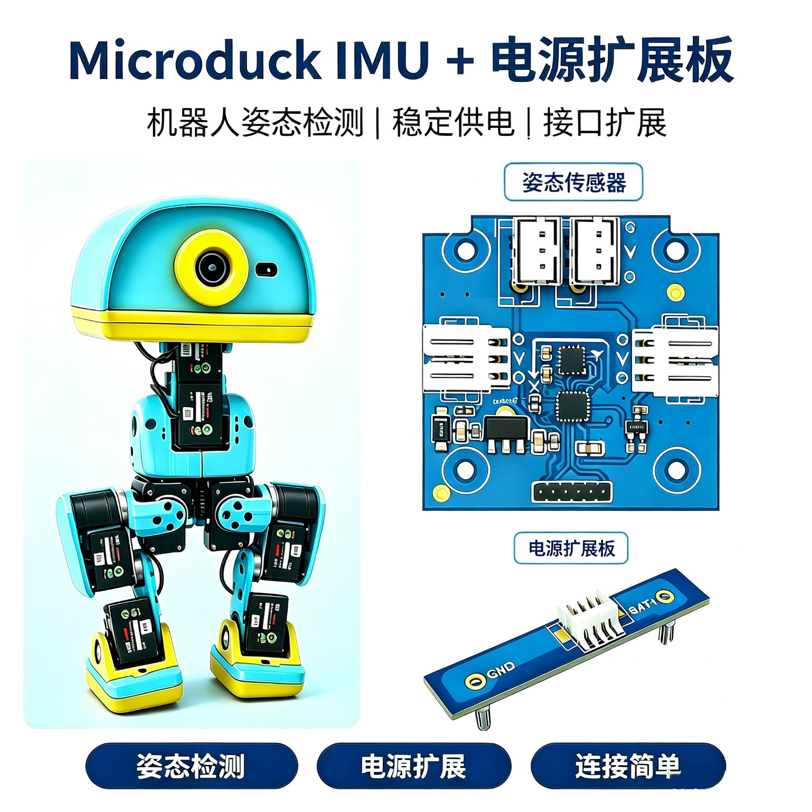
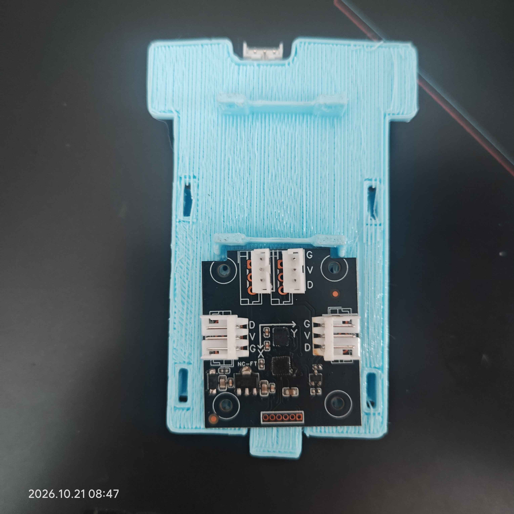

# Microduck HD1910 · IMU_TO_DXL v1.2

> 飞特（Feetech）/ Dynamixel 总线姿态传感器模块 —— **开发资料、调试工具与固件合集**

<p align="center">
  
</p>

<p align="center">
  <b>机器人姿态检测</b> · <b>稳定供电</b> · <b>接口扩展</b>
</p>

---

## 目录

- [项目简介](#项目简介)
- [资料清单](#资料清单)
- [硬件规格](#硬件规格)
- [通信协议速查](#通信协议速查)
- [快速上手](#快速上手)
- [固件升级（OTA）](#固件升级ota)
- [安装与结构](#安装与结构)
- [常见问题](#常见问题)
- [版本信息](#版本信息)

---

## 项目简介

**IMU_TO_DXL v1.2** 是一款面向机器人关节总线（飞特 SCS 系列 / Dynamixel）的 **6 轴姿态传感器从站模块**。
它把 MEMS IMU 的姿态解算结果直接挂到舵机总线上，主机用**一次同步读（Sync Read）**即可把它和其他舵机
一起读回来，无需额外的串口或 I²C 通道。

模块内置 **LSM6DSV16X** 的 SFLP 硬件融合引擎，输出**四元数 + 陀螺仪角速度**，120 Hz 更新，
最坏姿态延迟约 8.3 ms，适合做机器人的平衡、倾倒检测与姿态闭环。

本仓库为硬件资料的统一发布点，包含开发手册、出厂调试工具、OTA 升级工具与固件。

---

## 资料清单

| 路径 | 类型 | 说明 |
| :--- | :--- | :--- |
| [`imu_dev_guide.md`](imu_dev_guide.md) | 文档 | **开发手册（主文档）**：寄存器、帧格式、时序、Python 示例、FAQ |
| [`imu_使用指导手册.pdf`](imu_使用指导手册.pdf) | 文档 | 使用指导手册（PDF 版，便于分发/打印） |
| [`02_Firmware/IMU_TO_DXL_FT_APP_IAP_2026_11_1_0x42EBEAF4_2026_11_1.bin`](02_Firmware/IMU_TO_DXL_FT_APP_IAP_2026_11_1_0x42EBEAF4_2026_11_1.bin) | 固件 | 飞特（FT）协议 APP+IAP 固件，版本 2026_11_1 |
| [`01_Tool/imu_ota_tool.exe`](01_Tool/imu_ota_tool.exe) | 工具 | **总线 OTA 升级工具**（Windows，免拆机升级固件） |
| [`01_Tool/FD1985-250729/FD.exe`](01_Tool/FD1985-250729/FD.exe) | 工具 | 飞特官方 FD 调试工具（改 ID、波特率、参数读写） |
| [`01_Tool/FD1985-250729/ft_setup_bat/`](01_Tool/FD1985-250729/ft_setup_bat/) | 脚本 | 出厂参数配置批处理与配置日志（PWM / Modbus 等） |
| [`安装示意图.jpg`](安装示意图.jpg) | 图片 | 模块装入结构件后的实际安装示意 |
| [`microduck_imu.png`](microduck_imu.png) | 图片 | 产品与电源扩展板示意图 |

> ⚠️ `01_Tool/` 下的可执行文件为 Windows 程序，首次运行如被 SmartScreen 拦截，
> 请选择「仍要运行」。

---

## 硬件规格

| 项目 | 参数 |
| :--- | :--- |
| 型号 | IMU_TO_DXL v1.2 |
| 主控 | CH32V203（RISC-V，96 MHz） |
| 传感器 | LSM6DSV16X（6 轴，内置 SFLP 硬件融合引擎） |
| 协议 | 飞特 SCS 系列 / Dynamixel（**二选一固件**） |
| 从站 ID | **200**（`0xC8`，可改） |
| 波特率 | **1 Mbps** |
| 物理层 | 单线半双工 UART，TTL 3.3 V |
| 姿态输出 | 四元数（3×half 浮点）+ 陀螺仪角速度（3×int16） |
| 输出频率 | **120 Hz** |
| 姿态延迟 | 约 8.3 ms（最坏） |
| 板子尺寸 | 34.0 × 42.3 mm，板厚 1.6 mm |
| 固件升级 | 总线 OTA（不用拆机） |
| 接口 | 3 针总线座（G / V / D）+ 电源扩展板接口 |

---

## 通信协议速查

### 数据块位置

IMU 作为总线上的一个普通从站，主机用**同步读**一次取回数据。

| 协议 | 起始地址 | 长度 | 说明 |
| :--- | :--- | :--- | :--- |
| **飞特 FT** | **56**（`0x38`） | **15** | 紧凑块，**推荐** |
| Dynamixel XL | 124（`0x7C`） | 12 | 兼容官方布局 |

### 15 字节布局（小端）

| 偏移 | 长度 | 字段 | 类型 | 说明 |
| :--- | :--- | :--- | :--- | :--- |
| 0–1 | 2 | `gyro_x` | int16 | 陀螺仪 X 角速度原始值 |
| 2–3 | 2 | `gyro_y` | int16 | 陀螺仪 Y |
| 4–5 | 2 | `gyro_z` | int16 | 陀螺仪 Z |
| 6–7 | 2 | `quat_x` | IEEE754 half | 四元数 X |
| 8–9 | 2 | `quat_y` | IEEE754 half | 四元数 Y |
| 10–11 | 2 | `quat_z` | IEEE754 half | 四元数 Z |
| **12** | 1 | `sequence` | uint8 | **只在有新四元数时 +1** |
| **13** | 1 | `status` | uint8 | 状态位，见下 |
| 14 | 1 | `reserved` | uint8 | 保留，固定 0 |

> 四元数只发 3 个分量，**主机需自行补 W = √(1 − x² − y² − z²)**。

### 同步读请求 / 应答

**请求：**

```
FF FF  FE  LEN  82  ADDR  RLEN  ID1  ID2 ... IDn  CHK
```

**应答（21 字节）：**

```
FF FF  C8  11  00  D0 ... D14  CHK
```

实测示例（16 个设备，ID 200 排在首位）：

```
FF FF FE 14 82 38 0F C8 14 15 16 17 18 1E 1F 20 21 0A 0B 0C 0D 0E XX
```

校验和：`CHK = ~(ID + LEN + INST + Σparams) & 0xFF`

### 状态位（字节 13）

**BIT = 1 表示异常。**

| 位 | 名称 | 含义 | 建议处理 |
| :--- | :--- | :--- | :--- |
| `0x01` | NOT_READY | 还没输出过有效四元数 | 上电后等它清零 |
| **`0x02`** | **STALE** | **距上次新四元数 > 30 ms** | **数据过期，不要用于闭环** |
| `0x04` | SELF_TEST | WHO_AM_I 校验失败 | 硬件异常，联系售后 |
| **`0x08`** | **READER_SLOW** | **上次读取后又积累了 ≥5 个新样本** | **主机读得太慢，提高读取频率** |

### 总线时序（重要）

| 项目 | 数值 |
| :--- | :--- |
| 包间隔 | **60 µs** |
| 单设备时隙 | **270 µs** = 60 包间隔 + 210 应答长度 |
| 1 Mbps 下每字节 | 10 µs |
| 21 字节应答 | 210 µs |

**三条必须遵守的规则：**

1. **ID 200 必须排在同步读 ID 列表的第一位** —— 协议按 ID 顺序分配时隙，排第一就是「主机发完立刻回」。
2. **不要让其他设备插在 200 前面**，否则会占用别人的时隙，两边都可能出错。
3. **波特率必须精确 1 Mbps**，误差 < ±2%（用 12 MHz 晶振或更高的 PLL 时钟，不要用内部 RC）。

---

## 快速上手

### 1. 接线

模块是**单线半双工**，PC 测试需要 USB 转单线半双工适配器（TTL 3.3 V）。

| 模块引脚 | 接到 |
| :--- | :--- |
| `BAT+` | 电池正极（电压范围以实物丝印/手册为准） |
| `GND` | 电池负极（**必须共地**） |
| `BUS` | 单线总线（TX/RX 合并） |

### 2. PC 端读数据

```python
import serial

ID_IMU, ADDR, LEN, BAUD = 200, 56, 15, 1000000

def ft_checksum(body: bytes) -> int:
    return (~sum(body)) & 0xFF

def build_sync_read(ids):
    body = bytes([0xFE, len(ids) + 4, 0x82, ADDR, LEN] + list(ids))
    return b'\xFF\xFF' + body + bytes([ft_checksum(body)])

ser = serial.Serial('COM3', BAUD, timeout=0.05)
ser.write(build_sync_read([ID_IMU]))
frame = ser.read(21)                      # FF FF C8 11 00 <15B> CHK
```

完整的解析、半精度浮点解码与倾角计算示例见
[`imu_dev_guide.md` 第 5 节](imu_dev_guide.md#52-python-测试脚本)。

### 3. 接入舵机总线

把模块的 3 针总线座串到舵机总线上，然后：

- 同步读列表里**第一位**放 `C8`（ID 200）；
- `ADDR = 0x38`、`RLEN = 0x0F`；
- 读取频率建议 **≥ 50 Hz**，避免触发 `READER_SLOW`。

### 4. 验收检查表

| 检查项 | 期望 | 不符合时看 |
| :--- | :--- | :--- |
| 有应答 | 21 字节 `FF FF C8 11 00 ...` | 总线接法 / 波特率 / ID |
| 采样率 | 110–125 Hz | 主机读得太慢（`READER_SLOW`） |
| 静止倾角 | ≈ 0°（±3° 内） | 安装面不平，重新标定 |
| 静止 gyro | ±1 dps 内 | 正常零偏，融合会自动校正 |
| `status` bit0 | 上电几秒后为 0 | 融合未启动 |
| `status` bit1 | 一直为 0 | 主机读得太慢（> 30 ms 一次） |
| 翻转模块 | 倾角跟着变化 | 姿态解算异常 |

---

## 固件升级（OTA）

模块支持**总线 OTA**，无需拆机、无需 SWD 烧写器。

1. 接线：把模块挂到总线上，用 USB 转单线半双工适配器连到 PC；
2. 打开 [`01_Tool/imu_ota_tool.exe`](01_Tool/imu_ota_tool.exe)；
3. 选择对应串口与固件文件
   [`IMU_TO_DXL_FT_APP_IAP_2026_11_1_0x42EBEAF4_2026_11_1.bin`](02_Firmware/IMU_TO_DXL_FT_APP_IAP_2026_11_1_0x42EBEAF4_2026_11_1.bin)；
4. 按提示烧写，完成后重新上电。

> 固件文件名遵循 `IMU_TO_DXL_<协议>_<类型>_<版本>_<校验>_<日期>.bin`：
> `FT` = 飞特协议，`APP_IAP` = 应用区 + 引导区。
> **刷入不同协议的固件后，数据块起始地址会变化**（FT 为 56，Dynamixel 为 124），主机代码需同步修改。

改 ID / 波特率等参数请使用 [`01_Tool/FD1985-250729/FD.exe`](01_Tool/FD1985-250729/FD.exe)；
出厂默认配置记录在 [`ft_setup_bat/`](01_Tool/FD1985-250729/ft_setup_bat/) 的日志中，可作为恢复依据。

---

## 安装与结构

模块通过 3D 打印支架固定在机器人头部/躯干，接线沿结构件走线槽引出：

<p align="center">
  
</p>

装配时注意：

- 固定螺钉不要过力，避免压弯 PCB（板厚仅 1.6 mm）；
- **安装面必须与机体坐标轴对齐**，否则需要做安装标定（`imu_mount_quat`）；
- 线束留出余量，避免头部转动时拉扯总线座。

---

## 常见问题

**Q：读不到应答？**
依次排查：① 波特率是否为 1 Mbps；② 同步读里 ID 200 是否排**第一位**；
③ `ADDR` 是否 `0x38`、`RLEN` 是否 `0x0F`；④ 单线半双工方向转换是否正常（TX 发完要及时释放总线）；⑤ 是否可靠共地。

**Q：能读到数据但倾角不对？**
四元数需用安装标定旋转到机体系；只发 3 个分量，主机必须自己补 `W`；检查 half 浮点是否为 16 位小端。

**Q：`status` 一直是 `0x08`（READER_SLOW）？**
主机读取间隔太长，建议读取频率 ≥ 50 Hz。

**Q：`status` 出现 `0x02`（STALE）？**
说明距上次新四元数超过 30 ms，通常是内部融合卡住或总线通信中断，检查供电与总线。

**Q：陀螺仪有 1–2 dps 零偏，正常吗？**
正常，属消费级 IMU 固有零偏，SFLP 会在线估计并补偿。

**Q：改了 ID 就读不到了？**
同步读列表里必须用新 ID，且仍排在第一位。

更多问题请见 [`imu_dev_guide.md` 第 6 节](imu_dev_guide.md#6-常见问题)。

---

## 版本信息

| 项目 | 版本 |
| :--- | :--- |
| 硬件 | IMU_TO_DXL v1.2 |
| 固件 | 2026_11_1（FT 协议，APP+IAP） |
| 调试工具 | FD1985-250729 |

### 许可与声明

- 资料按「现状」提供，仅用于配套硬件的开发、调试与集成；
- 固件与文档版权归 Microduck / 原始设计方所有，未经许可请勿用于商业再分发；
- 原理图与 PCB 源文件不随本仓库提供，如有需要请联系技术支持；
- 若需定制固件（协议映射、输出频率、坐标系）请联系技术支持。

---

<p align="center"><sub>Microduck HD1910 · IMU_TO_DXL v1.2</sub></p>
